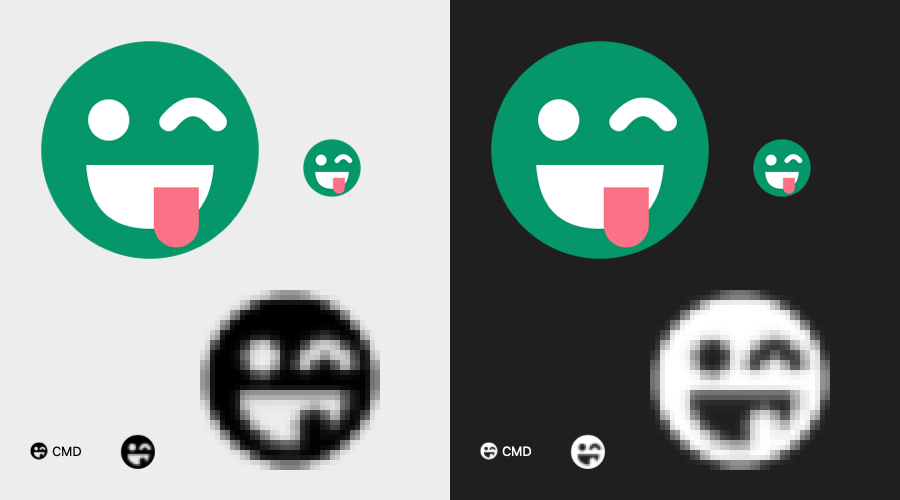

# NH-32: A fun logo for the README and the menu bar — Design

**Date:** 2026-11-08  **Ticket:** [NH-32](https://github.com/noahstotland/nohands/issues/32)
**Status:** Shipped
**Shipped:** in PR #100, as specified

## Intent

NoHands has a placeholder logo (a green square with a white "N") and borrows the SF Symbol `mic` for its menu-bar icon.
It should have a face of its own, and a cheeky one, because the name is a joke: look, no hands. The same logo goes in
the README and the menu bar, and NH-33 later builds the full-colour app icon from it.

## The logo

A round green face, winking, with a big open grin and its tongue out. The face does everything with its mouth, and it
knows it. That is the whole "look, no hands" joke, told without drawing any hands.



The preview is a working draft, rendered from the SVG below. It shows the glyph beside mock `CMD` text at actual size
(18 px), then at 2x, then the 18 px version enlarged so the pixels are visible.

Two pieces of art, same drawing:

- **Colour logo** (`assets/icon.svg`, 64 by 64 viewBox): a green disc in the placeholder's `#059669`, white eye, white
  wink, white grin, pink tongue (`#FB7185`) that hangs just past the lip. Plain shapes only, no text or fonts, so
  GitHub renders it the same everywhere.
- **Menu-bar glyph** (`assets/menubar-icon.svg`, 18 by 18 viewBox): a one-colour cut of the same face. The eye, the
  wink and the mouth are holes in a solid disc, and the tongue is a solid shape inside the mouth. Details are thicker
  than a straight scale-down of the colour logo would give, so that they hold up at 18 px.

Drafts of both, which the build may nudge for pixel alignment:

```svg
<svg xmlns="http://www.w3.org/2000/svg" viewBox="0 0 64 64">
  <circle cx="32" cy="32" r="29" fill="#059669"/>
  <circle cx="21" cy="24" r="5.5" fill="#fff"/>
  <path d="M37 24.5 Q43.5 16.5 50 24.5" fill="none" stroke="#fff" stroke-width="5" stroke-linecap="round"/>
  <path d="M15 36 H49 Q48 53 32 53 Q16 53 15 36 Z" fill="#fff"/>
  <path d="M33 42 H45 V52 A6 6 0 0 1 33 52 Z" fill="#FB7185"/>
</svg>
```

```svg
<svg xmlns="http://www.w3.org/2000/svg" viewBox="0 0 18 18">
  <defs><mask id="m"><rect width="18" height="18" fill="#fff"/>
    <circle cx="6" cy="6.5" r="1.75" fill="#000"/>
    <path d="M10.2 7 Q12.2 3.9 14.2 7" fill="none" stroke="#000" stroke-width="1.7" stroke-linecap="round"/>
    <path d="M3.75 10 H14.25 C14.25 13 12 15 9 15 C6 15 3.75 13 3.75 10 Z" fill="#000"/>
    <rect x="9.5" y="11.5" width="3.2" height="4" rx="1.6" fill="#fff"/>
  </mask></defs>
  <circle cx="9" cy="9" r="8.5" fill="#000" mask="url(#m)"/>
</svg>
```

## Goals and non-goals

Goals are the ticket's Scope and Acceptance.

Non-goals are the ticket's Out of scope: the `.icns` app icon (NH-33), menu text and HUD copy, and icon states for
listening, sleeping or paused.

Anti-goals, which would make this a failure even if the build passes:

- The logo mocks missing hands or disability. NoHands will be used by people who can't use their hands, so the joke is
  on the face's attitude, never on a body.
- The icon is a smudge at 1x, or a fixed black shape that vanishes on a dark menu bar.
- The mode text beside the icon moves or changes.
- The app fails to start, or shows an empty menu-bar item, when the image can't be found.

## Approaches

1. **Winking, tongue-out face (chosen).** Three features on a disc survive at 18 px, as the preview shows. Reads as
   playful at once, and a disc gives NH-33 an easy shape to work with.
2. **A microphone with a face.** The most literal link to voice, and close to today's `mic` icon. Rejected because the
   capsule would be roughly 8 px wide in the menu bar (an estimate, not drawn), which leaves no room for an expression, so it reads as a plain mic.
3. **A hand with a cross through it, or a figure with arms that stop short.** The most literal "no hands". Rejected:
   a prohibition sign reads as a warning, and short arms are the anti-goal above.

For the menu-bar asset, two options: committed PNGs at 1x and 2x, or a single PDF or SVG drawn by AppKit at run time.
The ticket asks for 1x and 2x sizes in an asset the bundle ships, and PNGs let the 18 px version be checked pixel by
pixel, so PNGs.

## What changes

- `assets/icon.svg`: replaced with the colour logo.
- `assets/menubar-icon.svg`: new, the glyph source.
- `scripts/render-menubar-icon.swift`: new, a small dev script that draws the glyph SVG through AppKit (`NSImage` reads
  SVG on macOS 14, confirmed in the spike) into `Resources/MenuBarIcon.png` (18 by 18) and `Resources/MenuBarIcon@2x.png`
  (36 by 36), keeping the alpha channel. It needs no new tools. It is run by hand when the art changes, not by the build.
- `Resources/MenuBarIcon.png` and `Resources/MenuBarIcon@2x.png`: new, committed output of that script.
- `scripts/bundle.sh`: copies both PNGs into `NoHands.app/Contents/Resources` before signing. The existing `codesign`
  step stays last.
- `Sources/NoHands/AppDelegate.swift`, `buildMenu()`: loads `NSImage(named: "MenuBarIcon")`, which picks up the `@2x`
  file by itself, sets `isTemplate = true` and `size` to 18 by 18, and sets the accessibility description to
  `"NoHands"`. If the image is missing, as in an unbundled `swift run`, it falls back to the current `mic` symbol.
  `imagePosition` and `refresh()` don't change.
- `README.md`, line 1: the `src` stays, because the file name doesn't change. `alt=""` becomes `alt="NoHands logo"`.
- `Resources/Info.plist`: no change. Loose images in `Contents/Resources` need no key.

## Testing

No unit tests. `AGENTS.md` § Testing excludes menu-bar layout, constants and framework behaviour, and this change has
no logic beyond one fallback.

- `swift build` and `swift test` pass.
- Manual, listed in the PR: built with `scripts/bundle.sh`, the icon on a real menu bar is crisp at 1x and 2x, correct
  in light and dark mode, reads at menu-bar size, and sits beside the mode text as before.

## Left to the builder

Pixel nudges to the glyph and small shape changes to the colour logo that keep the concept, and the exact script
arguments.

## Calls I made

- **The concept is a winking, tongue-out face**, not a microphone or a hand. The ticket left it to the designer.
- **No hands or arms are drawn at all**, because arm or stump jokes would land on the people this app may help most.
- **The green stays**, carried over from the placeholder, with pink added only for the tongue.
- **The README stays at 64 px** in the same spot, and its empty alt text becomes "NoHands logo", a small
  accessibility fix on the line the ticket already touches.
- **PNGs are committed**, and a small script regenerates them, so the build gains no step and no dependency.
- **The menu bar falls back to `mic`** when the image is missing, so an unbundled run still shows an icon.
- **The glyph is 18 pt**, the top of the ticket's 16 to 18 pt range, to give the wink as much room as the ticket allows.
- **A preview image is committed next to this spec** so the logo can be judged from GitHub before it is built.
