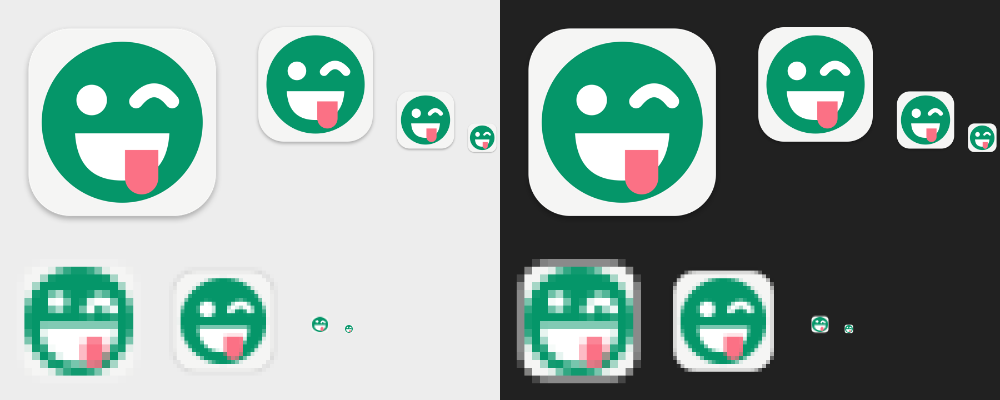

# NH-33: A full-colour app icon: Design

**Date:** 2026-11-09  **Ticket:** [NH-33](https://github.com/noahstotland/nohands/issues/33)
**Status:** Shipped
**Shipped:** in PR #114, as specified

## Intent

`NoHands.app` has no icon, so macOS shows the generic one. This ticket makes the NH-32 face (a green winking disc with its tongue out) the app icon, in the macOS icon shape and every standard size.

## What the code forces

NoHands never appears in the Dock or Cmd-Tab while it runs (`LSUIElement` in `Resources/Info.plist`, the `.accessory` policy in `main.swift`). The ticket asked for the icon there, but an icon alone can't do that, and becoming a Dock app is a product change it doesn't ask for. So NoHands stays a menu-bar app. The icon shows in Finder, Launchpad, a pinned Dock tile, the app's alerts and System Settings' privacy lists.

## The icon

The NH-32 disc, unchanged, sits on an off-white (`#F5F5F4`) rounded-square tile on Apple's grid: an 824 px body on a 1024 px canvas, about 185 px corner radius, and a drop shadow (28 px blur, 12 px down, 30% black, scaled with size).

- **Main art** (`assets/app-icon.svg`) is used for every size except 16 px.
- **16 px cut** (`assets/app-icon-small.svg`) drops the margin and shadow and thickens the eye, wink, mouth and tongue, because a straight scale-down smears the wink.

## Anti-goals

- Not changing the logo, menu-bar icon or `LSUIElement`; no dark variant.
- Failures even if the build passes: a face that no longer looks like NH-32, a smudge in Finder list view, or the icon copied after `codesign` (it breaks the signature Accessibility trust is tied to).

## What changes

- `assets/app-icon.svg`, `assets/app-icon-small.svg`: the art.
- `scripts/render-app-icon.swift`: a hand-run script that renders an `.iconset` (16 to 512 pt, 1x and 2x, shadow on all but 16 px) and writes `Resources/AppIcon.icns` through `iconutil`. The `.icns` is committed, so the build gains no step.
- `Resources/Info.plist`: `CFBundleIconFile` is `AppIcon`.
- `scripts/bundle.sh`: copies the `.icns` into the bundle before `codesign`.

## Testing

No unit tests: no logic. After `scripts/bundle.sh`, `codesign --verify --deep --strict` passes. Judging the icon in Finder is manual.

## Calls I made

- NoHands stays a menu-bar app, which narrows the ticket's acceptance.
- Off-white tile (chosen over a green or deep green tile, where the disc is lost or the greens merge at 16 and 32 px).
- A separate thicker 16 px drawing, as NH-32 did for the menu bar.
- Checked only on macOS 14. macOS 26 may redraw older icons in its own tile.
